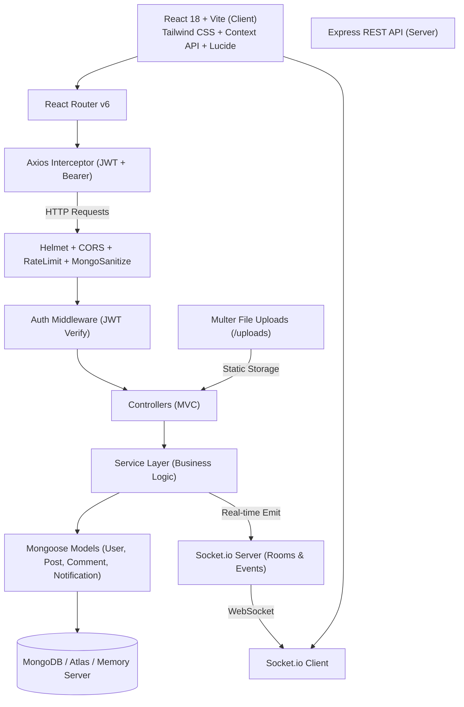
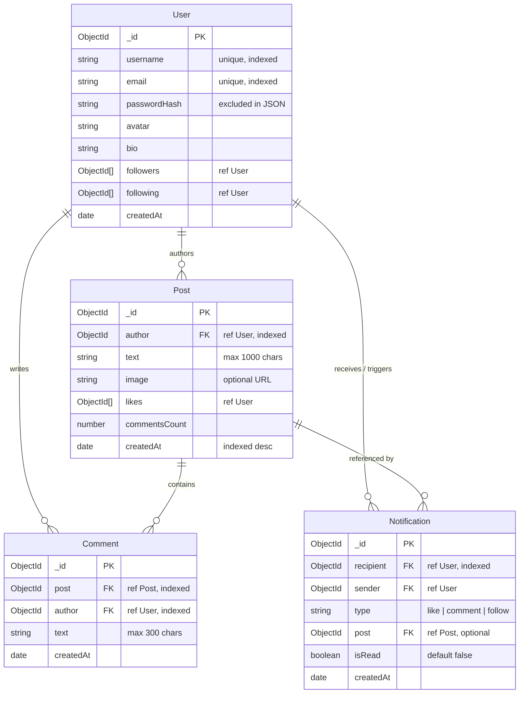

# 🌐 ConnectSphere — Mini Social Media Platform

> **CodeAlpha Full Stack Development Internship (Task 2)**  
> Built by a Senior Full-Stack Engineer with React 18, Vite, Node.js, Express, MongoDB (Mongoose), Tailwind CSS, and Socket.io.

[](https://jestjs.io/)
[](https://nodejs.org/)
[](LICENSE)

---

## 📖 1. Overview

**ConnectSphere** is a modern, responsive, production-quality mini social media web platform engineered to deliver seamless community interactions. Designed following clean architecture principles (MVC with a Service layer), ConnectSphere features real-time interactions, persistent dark/light theme switching, full responsive mobile bottom navigation, optimistic UI updates, and robust security protections.

---

## ✨ 2. Key Features

### 🔐 User Authentication & Authorization
- **JWT Authentication**: Secure stateless token issuance and verification with HTTP Bearer Authorization headers.
- **Bcrypt Hashing**: Passwords securely hashed with salt rounds (10+); `passwordHash` is never leaked or returned in responses.
- **Protected Routes**: Navigation guards prevent unauthorized access on both client and API routes.
- **Rate Limiting**: Brute-force protection on auth endpoints using `express-rate-limit`.

### 👤 User Profiles & Follow System
- **Instagram-Style Profile Header**: Modern layout with user avatar, username, join date, interactive bio, and real-time stats counters (post count, follower count, following count).
- **Follow / Unfollow Mechanism**: Instant toggle with self-follow prevention (enforced at API level with 400 Bad Request).
- **Interactive Modals**: Clickable follower/following counters to view member rosters.
- **Profile Customization**: Edit bio, upload new avatar images with live preview via Multer.
- **Who-To-Follow Sidebar**: Recommended creators to expand community reach.

### 📝 Posts, Media & Interaction
- **Rich Post Composer**: Create posts with text (up to 1,000 characters), character counter, and optional image uploads (JPEG, PNG, WEBP, GIF up to 5MB).
- **Optimistic UI Like Toggle**: Immediate visual heart burst animation (`animate-heart`) with instant like count increment/decrement.
- **Post Editing & Deletion**: Owner-only authorization guard (403 Forbidden for non-owners) with cascade deletion of related comments and notifications.
- **Direct Link Sharing**: One-click URL copy with animated toast alerts.

### 💬 Threaded Comments
- **Real-Time Commenting**: Add and view comments per post, complete with author avatars and relative timestamps (`formatDistanceToNow`).
- **Owner Deletion**: Comment authors can delete their comments, automatically decrementing post comment counters.

### 📰 Home Feed & Exploration
- **Smart Feed Aggregation**: Chronological feed containing posts from users you follow + your own posts.
- **Auto-Discovery Fallback**: New users with 0 followed accounts automatically see trending platform posts to immediately engage.
- **Pagination & Infinite Loading**: Efficient page/limit aggregation queries.
- **Live User Search**: Instant regex search by username or keywords in bio.

### 🔔 Real-Time Notifications (Socket.io)
- **Live Event Dispatch**: Instant alerts for Likes, Comments, and Follows delivered in real-time over WebSocket.
- **Notification Inbox**: Read/unread badges, sender avatars, post snippet previews, and one-click "Mark All as Read".

### 🎨 Premium UI / UX
- **Inter Typography**: Clean, modern aesthetic with soft shadows (`shadow-soft`) and rounded cards.
- **Dark Mode**: Persisted dark/light theme toggle saved in `localStorage` and synchronized with CSS variables.
- **Mobile First Design**: Sticky header and responsive bottom navigation bar on mobile viewports.
- **Feedback & States**: Skeleton shimmer loaders, toast notification system, and friendly empty states.

---

## 🏗️ 3. Architecture & Tech Stack

### High-Level Architecture Diagram



### Tech Stack Breakdown

| Layer | Technologies |
| :--- | :--- |
| **Frontend** | React 18, Vite, Tailwind CSS, Lucide React, React Router DOM v6, Axios, Date-fns, Socket.io-client |
| **Backend** | Node.js, Express.js (MVC + Service Layer), Socket.io |
| **Database** | MongoDB with Mongoose ODM (includes zero-config in-memory fallback for instant dev/eval) |
| **Authentication** | JWT (JSON Web Tokens), Bcryptjs |
| **Security** | Helmet, CORS, Express-Rate-Limit, Express-Mongo-Sanitize, Centralized Error Handling |
| **File Storage** | Multer disk storage (served at `/uploads`), Cloudinary-ready abstraction |
| **Testing** | Jest, Supertest |

---

## 📊 4. Data Models & Indexes



---

## 🚀 5. Quick Start & Setup

### Prerequisites
- **Node.js** v18+ (tested on Node v25)
- **npm** v9+
- *(Optional)* MongoDB Atlas connection string. If omitted, the app **automatically launches an in-memory MongoDB instance** out-of-the-box!

### Installation

1. **Clone the repository:**
   ```bash
   git clone https://github.com/your-username/CodeAlpha_SocialMediaPlatform.git
   cd CodeAlpha_SocialMediaPlatform
   ```

2. **Install all dependencies (root, backend, frontend):**
   ```bash
   npm run install:all
   ```

3. **Configure Environment Variables:**
   Copy the provided `.env.example` to `server/.env`:
   ```bash
   cp .env.example server/.env
   ```
   *(Defaults are pre-configured to work immediately on localhost).*

4. **Seed Demo Accounts & Content:**
   ```bash
   npm run seed
   ```
   *Creates 5 demo users with posts, comments, likes, notifications, and follower graphs!*

5. **Start Both Client and Server:**
   ```bash
   npm run dev
   ```
   - **Frontend**: [http://localhost:3000](http://localhost:3000)
   - **Backend API**: [http://localhost:5000](http://localhost:5000)
   - **Health Check**: [http://localhost:5000/api/health](http://localhost:5000/api/health)

---

## 👥 6. Demo Accounts (1-Click Fill on Login Page)

Every demo account uses password: `password123`

| Username | Role / Niche | Followers | Bio Highlights |
| :--- | :--- | :---: | :--- |
| **`alex_tech`** | Full-Stack Engineer | 3 | React, Express, distributed systems, open-source |
| **`maya_designer`** | Product Designer | 3 | Design systems, micro-interactions, dark mode UX |
| **`dev_sam`** | Backend Developer | 2 | Node streams, MongoDB indexing, Redis caching |
| **`elena_photo`** | Visual Storyteller | 2 | Urban reflections, street aesthetics, golden hour |
| **`jordan_ai`** | AI/ML Researcher | 2 | Multi-agent coordination, LLMs, neural networks |

---

## 📡 7. API Reference

All responses strictly follow the standardized envelope:
```json
{
  "success": true,
  "data": { ... },
  "message": "Operation completed successfully"
}
```

### Authentication (`/api/auth`)
| Method | Endpoint | Access | Description |
| :--- | :--- | :--- | :--- |
| `POST` | `/api/auth/register` | Public | Register new user (username, email, password, bio) |
| `POST` | `/api/auth/login` | Public | Sign in with email or username + password |
| `GET` | `/api/auth/me` | Private | Retrieve authenticated user profile |

### Users & Follows (`/api/users`)
| Method | Endpoint | Access | Description |
| :--- | :--- | :--- | :--- |
| `GET` | `/api/users/search?q=` | Public | Search members by username or keywords in bio |
| `GET` | `/api/users/suggestions` | Private | Retrieve "Who To Follow" recommendations |
| `GET` | `/api/users/:username` | Public | Retrieve user profile, post count, and follower stats |
| `GET` | `/api/users/:username/posts` | Public | Retrieve all posts published by specific user |
| `PUT` | `/api/users/me` | Private | Update user bio and/or upload avatar image |
| `PUT` | `/api/users/:id/follow` | Private | Toggle follow/unfollow (self-follow blocked with 400) |

### Posts & Likes (`/api/posts`)
| Method | Endpoint | Access | Description |
| :--- | :--- | :--- | :--- |
| `GET` | `/api/posts/feed?page=1` | Private | Chronological feed of followed users + self |
| `POST` | `/api/posts` | Private | Create post (text + optional image file via Multer) |
| `GET` | `/api/posts/:id` | Public | Retrieve single post details |
| `PUT` | `/api/posts/:id` | Private | Edit post text (owner only, 403 otherwise) |
| `DELETE` | `/api/posts/:id` | Private | Delete post & cascade delete comments (owner only) |
| `PUT` | `/api/posts/:id/like` | Private | Toggle like/unlike with optimistic count |

### Comments (`/api/posts/:id/comments` & `/api/comments`)
| Method | Endpoint | Access | Description |
| :--- | :--- | :--- | :--- |
| `POST` | `/api/posts/:id/comments` | Private | Add comment & dispatch notification |
| `GET` | `/api/posts/:id/comments` | Public | Retrieve comments for post ordered chronologically |
| `DELETE` | `/api/comments/:id` | Private | Delete comment & decrement post count (owner only) |

### Notifications (`/api/notifications`)
| Method | Endpoint | Access | Description |
| :--- | :--- | :--- | :--- |
| `GET` | `/api/notifications` | Private | Paginated notifications list with unread counter |
| `PUT` | `/api/notifications/read` | Private | Mark all or specific notification as read |

---

## 🧪 8. Automated Testing

ConnectSphere includes comprehensive automated unit and integration tests using **Jest** and **Supertest**.

Run test suite:
```bash
npm test
```

### Test Coverage Highlights:
- ✅ User registration & JWT generation
- ✅ Duplicate email and username prevention
- ✅ Password hashing verification (`passwordHash` never leaked)
- ✅ Login credential verification & failure branches
- ✅ Token authentication guards (`401 Unauthorized` without Bearer token)
- ✅ Post CRUD and validation rules
- ✅ Ownership authorization checks (`403 Forbidden` on unauthorized edits/deletions)
- ✅ Like/unlike toggles & counter accuracy
- ✅ Comment creation & post comment counter synchronization

---

## ☁️ 9. Deployment Guidelines

### 1. Database — MongoDB Atlas
1. Create a free cluster on [MongoDB Atlas](https://www.mongodb.com/cloud/atlas).
2. Create a database user and whitelist `0.0.0.0/0` (or host IP).
3. Copy connection string into `MONGODB_URI` in your production environment.

### 2. Backend — Render / Railway
1. Connect your repository to [Render](https://render.com/).
2. Select **Web Service** with Root Directory set to `server`.
3. Build Command: `npm install`
4. Start Command: `node server.js`
5. Configure Environment Variables: `NODE_ENV=production`, `PORT=5000`, `MONGODB_URI`, `JWT_SECRET`, `CLIENT_URL`.

### 3. Frontend — Vercel / Netlify
1. Connect your repository to [Vercel](https://vercel.com/).
2. Root Directory: `client`
3. Framework Preset: **Vite**
4. Build Command: `npm run build`
5. Output Directory: `dist`
6. Add rewrite rule in `vercel.json` for single-page client routing:
   ```json
   {
     "rewrites": [{ "source": "/(.*)", "destination": "/index.html" }]
   }
   ```

---

## 🔒 10. Security Implementations

- **Helmet**: Secures HTTP response headers against cross-site scripting and sniffing.
- **CORS Whitelist**: Strict origin validation against `CLIENT_URL`.
- **NoSQL Injection Sanitization**: Uses `express-mongo-sanitize` to strip `$` and `.` operators from client inputs.
- **Rate Limiting**: Defends authentication endpoints from dictionary and brute-force attacks.
- **MIME-Type & Size Enforcement**: File uploads restricted strictly to safe image extensions and capped at 5MB.
- **Centralized Error Boundary**: Async error wrapper eliminates unhandled promise rejections and keeps internal stack traces concealed in production.

---

## 🔮 11. Future Roadmap

- [ ] Hashtags (`#tech`, `#design`) and trending topics feed
- [ ] Direct 1-on-1 private messaging via Socket.io channels
- [ ] Bookmarks / Saved posts library
- [ ] Video upload support with transcoding
- [ ] Multi-image carousel posts

---

## 📄 License
This project is open-sourced under the MIT License. Developed for the CodeAlpha Full Stack Development Internship.
